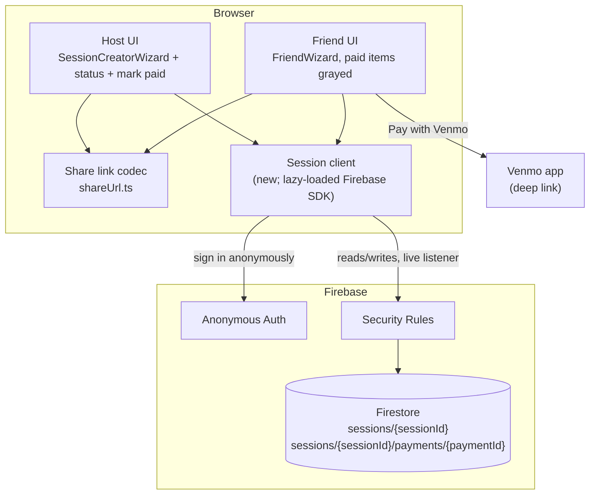
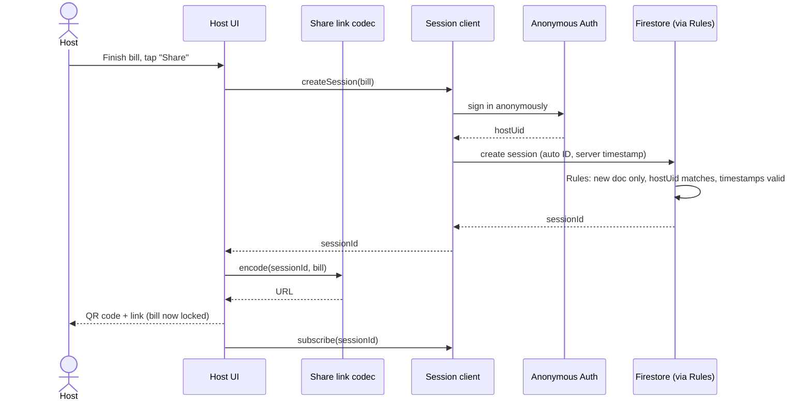
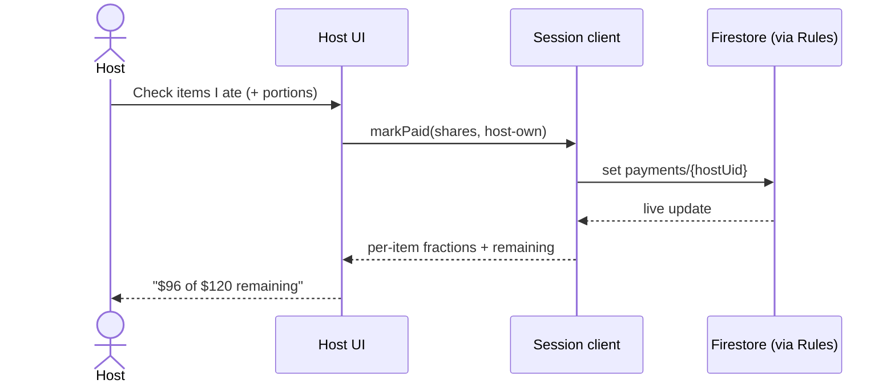
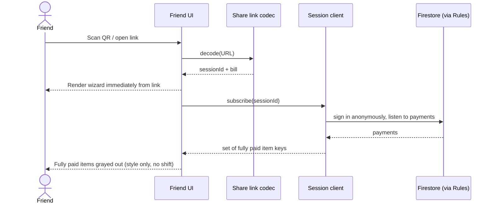
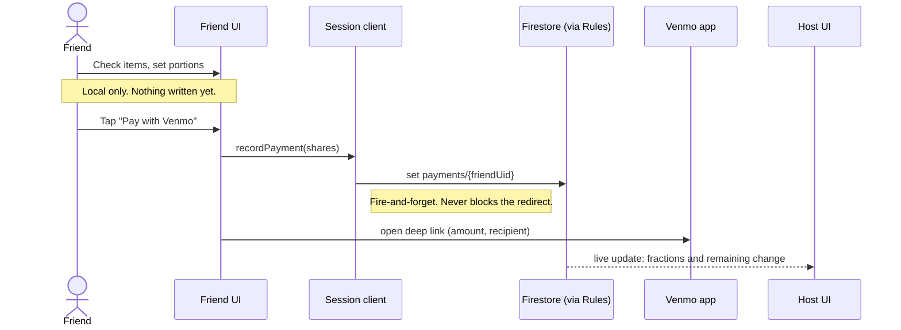
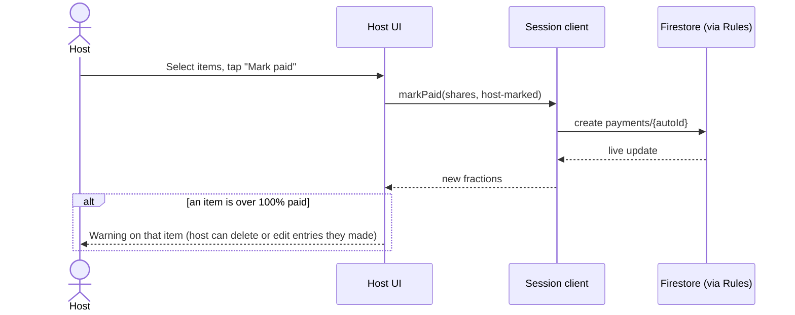
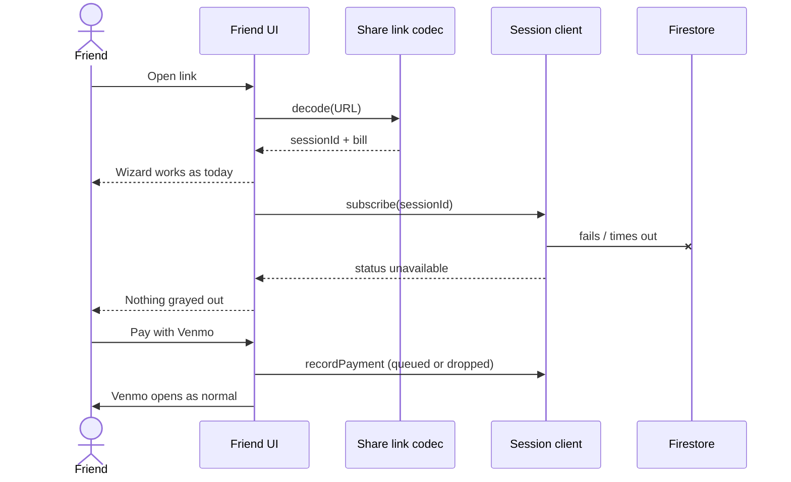
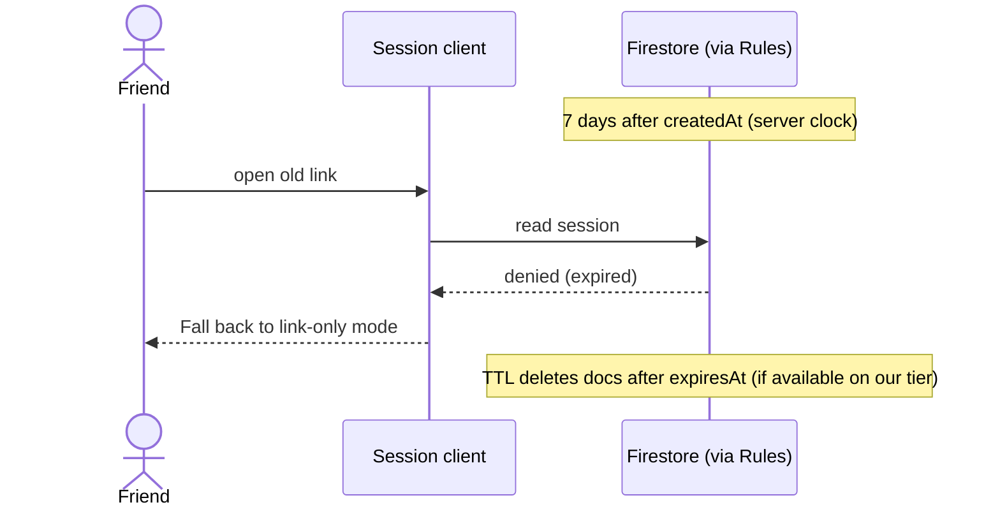

# Live Bill Status

## Problem

Once the host shares the link, the host can't see what's still unpaid. They have to collect Venmo notifications and work it out by hand.

## Goal

- **Host** sees, live, how much of each item has been paid (for example "Nachos: ⅔ paid") and what's left overall ("$36 of $120 remaining").
- **Friends** only see fully paid items grayed out, with no layout shift. Nothing else changes for them.
- **Anonymous.** We never ask for or show names.
- **No accounts and no login screens.**
- **No server code of our own.** The site stays on GitHub Pages.
- **Still works if the backend is down.** The wizard behaves exactly as today, just without status.

## Non-goals

- Proxying the OpenRouter API key (separate TODO).
- Checking that a Venmo payment really happened. We trust the click.
- Showing who paid for what.
- Editing the bill after it's shared. The bill is locked once shared (v1).

## Key concepts

- **Selecting vs paying.** In the friend wizard, a friend picks what they ate and their portions. This stays **on their device only**: nothing is written. Only tapping **"Pay with Venmo"** creates a **payment**, which records what that payment covered (item → fraction of the item).
- **Paid fraction** of an item = the sum of the fractions from all payments for that item.
- **Host payments** come in two kinds:
  - **The host's own food (main use).** The host marks what they ate, so the remaining amount reflects only what friends owe.
  - **Out-of-band payments (less common).** For example, someone paid cash, so the host marks those items paid.

## Approach: Firebase (Firestore + Anonymous Auth), called directly from the browser

- The Firebase config/API key is public by design. Firestore Security Rules running on Google's servers enforce who can write what.
- Anonymous Auth silently gives each browser a stable user ID (uid). It isn't linked to any identity. We use it only so a device can replace its own payment and can't touch anyone else's.
- Free Spark tier: no credit card, no idle pausing.

## Static architecture

### Components

| Component | Responsibility |
|---|---|
| **Host UI** | Builds and locks the bill, creates the session, shows the QR code/link. Marks the host's own items (and occasional out-of-band payments). Shows live per-item paid fractions and the amount remaining, and warns when an item is over 100% paid. |
| **Friend UI** | The existing 3-step wizard. Selections stay local. Fully paid items are grayed out, with no layout shift. "Pay with Venmo" records a payment, then opens Venmo. |
| **Share link codec** | Encodes `sessionId` **plus** the compressed bill (fallback and instant first render). |
| **Session client** | Thin Firebase wrapper: `createSession(bill) → sessionId`, `subscribe(sessionId)`, `recordPayment(...)`, `markPaid(...)`. Lazy-loaded. Becomes a no-op when Firebase is unreachable. |
| **Anonymous Auth** | Gives each browser a uid so the rules can scope writes. |
| **Security Rules** | Enforce ownership, server-side timestamps and expiry, valid item keys and fractions. |
| **Firestore** | Stores sessions and anonymous payments. |

### Item keys (content-based)

Item IDs are regenerated on decode and indexes are fragile, so each item gets a key derived from its content:

`key = normalize(name) + "|" + costInCents + "|" + n`

- `normalize` trims and lowercases the name.
- `n` is the occurrence number among items with the same name and cost. Two identical "Beer $7" lines become `beer|700|1` and `beer|700|2`.

The host and friends compute keys the same way from the same locked bill, so nothing extra goes in the link.

### Data model (sketch)

- `sessions/{sessionId}`
  - `hostUid`, `bill` (items with their keys, tax/tip, total)
  - `createdAt`: server timestamp
  - `expiresAt`: used only for cleanup
- `sessions/{sessionId}/payments/{paymentId}`
  - `ownerUid`
  - `shares`: item key → fraction of that item this payment covers (e.g. half of a split item = `0.5`)
  - `source`: `friend`, `host-own`, or `host-marked`
  - `createdAt`: server timestamp

Payment IDs:
- **Friend payments:** `paymentId = ownerUid`, one per device. Paying again replaces it instead of double-counting.
- **Host's own items:** `paymentId = hostUid`.
- **Out-of-band entries:** Firestore auto IDs.

Since every payment is its own document, concurrent payments never overwrite each other.

### Session ID and expiry: who decides

- **Session ID.** `createSession` takes only the bill. The ID is a 20-character random ID generated by the Firestore SDK.
  - The app never picks or passes one, but the browser does generate it. A truly server-generated ID needs server code (see Open questions).
  - The rules close the gap: create only (it can never overwrite an existing session), and the ID must look like an auto-ID.
- **Timestamps.** `createdAt` must equal the server's request time. The client sends a "server timestamp" placeholder and the rules check it, so the client can't backdate or extend a session.
- **Expiry.**
  - Access is cut off by the rules at `createdAt + 7 days`, using the server clock.
  - `expiresAt` exists only so Firestore's TTL feature can delete old documents. The rules require it to be within a few minutes of server time + 7 days.

### Rules (intent)

- **Session:**
  - Anyone signed in can create one as long as `hostUid` is their uid and the timestamps check out.
  - Anyone with the ID can read it.
  - It can't be updated once created (the bill is locked).
  - No access after 7 days.
- **Payments:**
  - A friend can write only the payment whose ID and `ownerUid` are their own uid.
  - The host can write their own payment and create, edit, or delete out-of-band entries.
  - Every key must exist in the bill, and every fraction must be between 0 and 1.
  - No writes after 7 days.
- **Discovery:** nobody can list sessions. Session IDs are random and unguessable, so you only get in with the link.

## Dynamic behaviour

### 1. Host creates and shares a session

### 2. Host marks their own items

The main use of "mark paid". It can happen before or after sharing, and the host can change it at any time.

### 3. Friend opens the link

### 4. Friend selects and pays

### 5. Host marks an out-of-band payment, overpayment warning

### 6. Firebase unreachable (fallback)

### 7. Expiry

## UI notes

- **Friend graying.** Change only color/opacity (and maybe strike through the price). No badges, text, or reordering, so nothing moves when status loads. Grayed items stay tappable in case the status is wrong. Partially paid items look normal.
- **Host status.** Per-item fraction, overall remaining, and a warning on any item above 100%.

## Rollout

1. Set up the Firebase project (Anonymous Auth + Firestore) and write the rules, with rule tests against the emulator.
2. Content-based item keys plus locking the bill once shared.
3. Session client: lazy-loaded and fails gracefully.
4. The share link carries `sessionId` alongside the bill. Old links keep working.
5. Host UI: mark own items, status view, mark paid, overpayment warning.
6. Friend UI: graying, and record the payment on Venmo click.
7. Turn on TTL if the free tier supports it.

## Open questions

- **Session ID generation.** Is the rules-guarded auto-ID acceptable, or do we want a truly server-generated ID? That would need a Cloud Function (pay-as-you-go plan with a card on file, still ~$0 at our volume) or a small Cloudflare Worker.
- **Should the host's own items be required before sharing?** Otherwise "remaining" overstates what friends owe until the host does it.
- **App Check, if spam appears (not v1).** It makes Firebase reject requests that don't come from our site running in a real browser. What it would take:
  - Register a reCAPTCHA v3 site key and enable App Check for the web app in the Firebase console.
  - Add `initializeAppCheck(...)` to the session client.
  - Add a debug token for localhost and the emulator.
  - Watch the metrics for a few days, then turn on enforcement for Firestore.
  - Costs: the reCAPTCHA script's weight, Google's reCAPTCHA notice on the site, and possible false positives on privacy-hardened browsers. It doesn't stop someone abusing the real site by hand.
