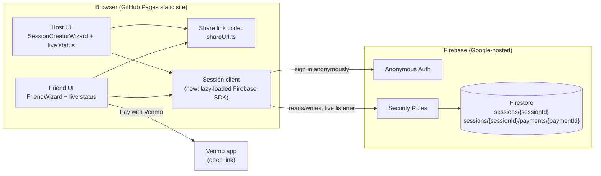
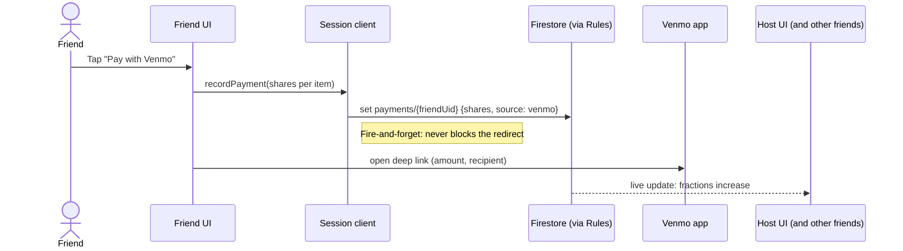
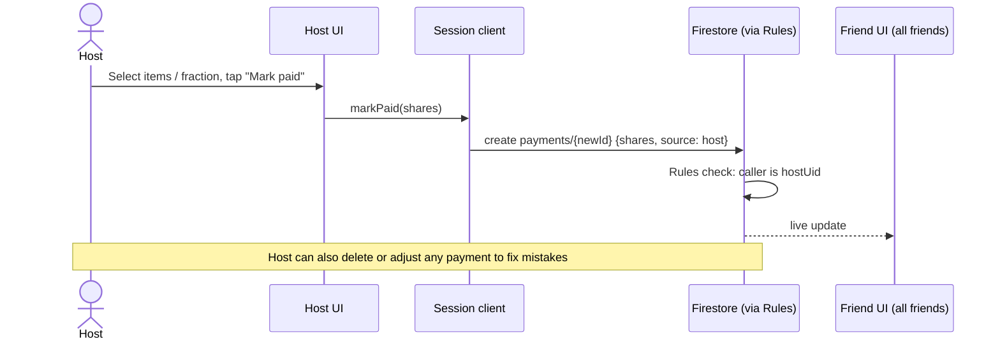
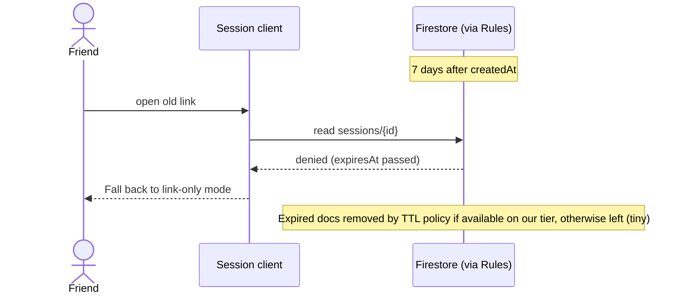

# Live Bill Status

## Problem

Once the host shares the link, nobody can see how much of the bill is covered. The host can't tell what's still unpaid, and friends can't tell which shared items others have already covered.

## Goal

Everyone with the link sees, live, **how much of each item has been paid**, as a fraction (for example, "Nachos: ⅔ paid"), plus an overall total ("$84 of $120 covered").

- **Anonymous.** We never ask for or show names. Typing your name is friction.
- **No accounts and no login screens.**
- **No server code of our own.** The site stays on GitHub Pages.
- **Still works if the backend is down.** The wizard behaves exactly as it does today, just without live status.

## Non-goals

- Proxying the OpenRouter API key (separate TODO).
- Checking that a Venmo payment really happened. We trust the click.
- Showing who paid for what.

## Approach: Firebase (Firestore + Anonymous Auth), called directly from the browser

- The Firebase config/API key is public by design. Firestore Security Rules running on Google's servers enforce who can write what.
- Anonymous Auth silently gives each browser a stable user ID (uid). The user never sees it, and it isn't linked to any identity. We use it only so a device can edit or undo its own payment and can't touch anyone else's.
- Free Spark tier: no credit card, no idle pausing. Our traffic is far below the limits.

See the earlier comparison of backend options for why we didn't pick P2P, Supabase, Cloudflare, or a VPS.

## Static architecture



### Components

| Component | Responsibility |
|---|---|
| **Host UI** | Builds the bill as today. Creates the session, shows the QR code/link, shows live status, and marks items as paid for out-of-band payments. |
| **Friend UI** | The existing 3-step wizard. Step 1 shows how much of each item is already paid. "Pay with Venmo" records the payment. |
| **Share link codec** | Encodes `sessionId` **plus** the compressed bill in the link (fallback and instant first render). |
| **Session client** | Thin wrapper around Firebase: create session, subscribe to status, record/undo payment, mark paid. Lazy-loaded so the calculator-only flow doesn't pay the SDK's size cost. Degrades to no-ops when Firebase is unreachable. |
| **Anonymous Auth** | Gives each browser a uid so rules can scope writes. |
| **Security Rules** | Enforce ownership, expiry, and valid fractions. |
| **Firestore** | Stores sessions and anonymous payment records. |

### Data model (sketch)

- `sessions/{sessionId}`
  - `hostUid`, `bill` (items, tax/tip, total), `createdAt`, `expiresAt` (createdAt + 7 days)
- `sessions/{sessionId}/payments/{paymentId}`
  - `ownerUid`
  - `shares`: map of item index → fraction of that item covered. For example, half of a split item is `0.5`, and a whole item is `1`.
  - `source`: `"venmo"` or `"host"`
  - `createdAt`

Each item's paid fraction is the sum of `shares[item]` across all payment records, capped at 1 for display. Summing on the client keeps each write independent: two friends paying at once never overwrite each other.

- Friend payment records use `paymentId = ownerUid`, one per device. Paying again replaces that device's record instead of counting twice.
- Host "mark paid" records use their own IDs, so the host can add several of them.

Items are keyed by **index in the bill**. Item IDs are regenerated on decode, so they aren't stable.

### Rules (intent, not syntax)

- **Session document:** anyone with the ID can read it. Only `hostUid` can create or update it. No reads or writes after `expiresAt`.
- **Payment records:**
  - Anyone signed in can create or replace a record with `ownerUid == their uid`.
  - The host can create, edit, or delete any record in their session.
  - Every fraction must be between 0 and 1, and item indexes must exist in the bill.
- **Discovery:** nobody can list sessions. Session IDs are random and unguessable, so you only get in with the link.

## Dynamic behaviour

### 1. Host creates and shares a session

```mermaid
sequenceDiagram
  actor Host
  participant HostUI as Host UI
  participant Link as Share link codec
  participant Client as Session client
  participant Auth as Anonymous Auth
  participant FS as Firestore (via Rules)

  Host->>HostUI: Finish bill, tap "Share"
  HostUI->>Client: createSession(bill)
  Client->>Auth: sign in anonymously
  Auth-->>Client: hostUid
  Client->>FS: create sessions/{id} {hostUid, bill, expiresAt}
  FS-->>Client: ok
  Client-->>HostUI: sessionId
  HostUI->>Link: encode(sessionId, bill)
  Link-->>HostUI: URL
  HostUI-->>Host: QR code + link
  HostUI->>Client: subscribe(sessionId)
  Note over HostUI,FS: Host now sees live status (all items 0% paid)
```

### 2. Friend opens the link and sees live status

```mermaid
sequenceDiagram
  actor Friend
  participant FriendUI as Friend UI
  participant Link as Share link codec
  participant Client as Session client
  participant Auth as Anonymous Auth
  participant FS as Firestore (via Rules)

  Friend->>FriendUI: Scan QR / open link
  FriendUI->>Link: decode(URL)
  Link-->>FriendUI: sessionId + bill
  FriendUI-->>Friend: Render wizard immediately from link
  FriendUI->>Client: subscribe(sessionId)
  Client->>Auth: sign in anonymously
  Auth-->>Client: friendUid
  Client->>FS: listen to session + payments
  FS-->>Client: current payments
  Client-->>FriendUI: per-item paid fractions
  FriendUI-->>Friend: "Nachos: ⅔ paid", "Burger: unpaid", ...
  loop whenever anyone pays
    FS-->>Client: updated payments
    Client-->>FriendUI: new fractions
  end
```

### 3. Friend pays with Venmo



### 4. Host marks items paid (out-of-band payment)



### 5. Firebase unreachable (fallback)

```mermaid
sequenceDiagram
  actor Friend
  participant FriendUI as Friend UI
  participant Link as Share link codec
  participant Client as Session client
  participant FS as Firestore

  Friend->>FriendUI: Open link
  FriendUI->>Link: decode(URL)
  Link-->>FriendUI: sessionId + bill
  FriendUI-->>Friend: Wizard works as today
  FriendUI->>Client: subscribe(sessionId)
  Client-xFS: fails / times out
  Client-->>FriendUI: status unavailable
  FriendUI-->>Friend: No paid indicators (quietly hidden)
  Friend->>FriendUI: Pay with Venmo
  FriendUI->>Client: recordPayment (queued or dropped)
  FriendUI->>Friend: Venmo opens as normal
```

### 6. Expiry



## Rollout

1. Set up the Firebase project, enable Anonymous Auth and Firestore, and write the rules. Add rule tests against the Firebase emulator.
2. Session client module with lazy loading and graceful failure.
3. Share link carries `sessionId` alongside the bill. Old links keep working.
4. Friend UI: paid-fraction indicators, and record a payment on Venmo click.
5. Host UI: live status view plus "mark paid".
6. Turn on TTL cleanup if the Spark tier supports it.

## Open questions

- Does the host's own share count? For example, auto-record the host's portion as paid, or just show "remaining" as total minus host's items.
- If a friend's paid amount pushes an item past 100%, do we warn, or just cap the display at 100%?
- What happens if the host edits the bill after sharing? The item indexes in existing payments could stop lining up. The simplest answer is to lock the bill once it's shared.
- Do we need App Check (blocks requests from outside our site) if spam appears? Not for v1.
